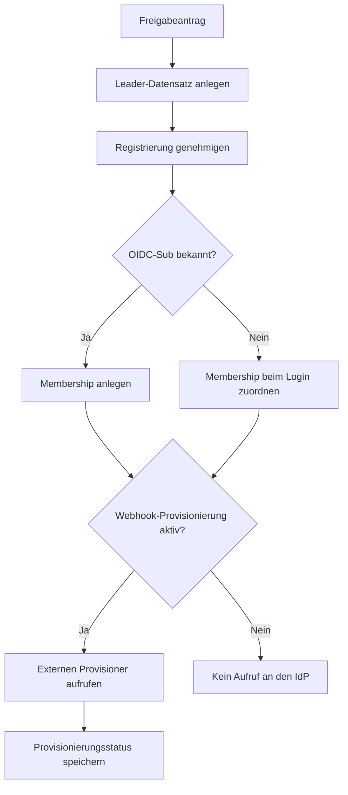
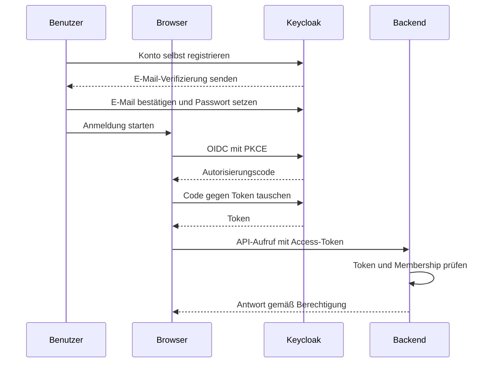

# Freigabe-Workflow fuer IDP-Benutzer

Dieses Dokument beschreibt den produktiven Onboarding-Ablauf fuer Benutzer, die sich ueber OIDC/IDP anmelden.

## Ziel

- Anmeldung bleibt IDP-basiert (OIDC).
- Fachzugriff wird erst nach interner Freigabe aktiviert.
- Zugriff wird strikt auf den zugewiesenen Scope (Bezirk oder Gemeinde) begrenzt.

## Ablauf (Überblick)

1. Benutzer registriert sich ueber die oeffentliche Registrierungsseite (`POST /api/v1/districts/{id}/registrations`).
2. Optional mitgesendeter Bearer-Token wird validiert; bei ungueltigem Token wird `401` geliefert.
3. Registrierung landet als `PENDING` im Bezirk.
4. Bezirksadministrator genehmigt (`POST .../{registration_id}/approve`):
   - `role` (`DISTRICT_ADMIN`, `CONGREGATION_ADMIN`, `PLANNER`, `VIEWER`)
   - `scope_type` (`DISTRICT` oder `CONGREGATION`)
   - `scope_id` (UUID des Bezirkes oder der Gemeinde)
5. Bei Genehmigung wird ein `Leader`-Datensatz erstellt. Eine `Membership` entsteht bei bekannter `user_sub` sofort, bei erfolgreicher optionaler Webhook-Provisionierung nach deren Antwort oder sonst beim ersten Login mit verifizierter E-Mail nach Freigabe.
6. Für Keycloak legt die Person ihr Konto selbst an, bestätigt die E-Mail-Adresse und setzt ihr Passwort; das Backend verschickt keine Keycloak-Einladung.
7. Nach Login ist der Benutzer aktiv, sobald mindestens eine Membership vorhanden ist.

## Detaillierter Ablauf bei Genehmigung

Nachfolgend wird Schritt für Schritt beschrieben, was im Backend passiert, wenn ein Bezirksadministrator eine Registrierung freigibt.



Ein Keycloak-Konto legt die Person selbst an (siehe [Konto anlegen und erster Login](#konto-anlegen-und-erster-login)); das Backend ruft Keycloak nicht auf.

### Schritt 1–3: Leader, Status, Membership

**Datei:** `services/backend/app/adapters/api/routers/registrations.py` (ab Zeile 270)

```python
# Leader anlegen
leader = Leader.create(name=..., district_id=..., rank=..., congregation_id=...)
await SqlLeaderRepository(db).save(leader)

# Registration als APPROVED markieren
reg.status = RegistrationStatus.APPROVED
reg.assigned_role = body.role
reg.assigned_scope_type = body.scope_type
reg.assigned_scope_id = body.scope_id
reg.approved_by_sub = auth.user_sub
reg.approved_at = datetime.now(UTC)

# Membership anlegen (wenn Benutzer bereits via OIDC verbunden)
if reg.user_sub is not None:
    await SqlMembershipRepository(db).upsert_by_scope(
        user_sub=reg.user_sub,
        role=body.role,
        scope_type=body.scope_type,
        scope_id=body.scope_id,
    )
```

### Schritt 4: Optionale Webhook-Provisionierung

**Datei:** `services/backend/app/adapters/idp/provisioning.py`

Der Provisioner wird über `get_idp_provisioner()` ermittelt:

| Provider | Konfiguration | Beschreibung |
|----------|--------------|-------------|
| `webhook` | `IDP_PROVISIONING_PROVIDER=webhook` + `IDP_PROVISIONING_ENDPOINT` | POST an externen Provisioning-Service |
| deaktiviert | `IDP_PROVISIONING_ENABLED=false` (Default) | Kein Aufruf an den IdP |

Das Backend hält **kein** Keycloak-Admin-Credential: Ein Keycloak-Provisioner existiert nicht mehr, und `IDP_PROVISIONING_ENABLED=true` mit `IDP_PROVISIONING_PROVIDER=keycloak` verweigert in jeder Umgebung den Start (Hinweis auf die Upgrade-Notiz [`699-keycloak-self-registration.md`](../operations/release-notes/699-keycloak-self-registration.md)). Jedes Admin-Recht mit dem Scope `manage` in Keycloak erlaubt Kontoübernahmen (E-Mail ändern und Einladung auslösen, OTP-/WebAuthn-Credentials löschen, externe Identität verknüpfen), auch mit feingranularen Berechtigungen (FGAP v2).

Falls kein Provider konfiguriert ist (`get_idp_provisioner()` gibt `None` zurück), wird die Freigabe trotzdem durchgeführt, nur ohne Aufruf an den IdP. Ein unbekannter Provider-Wert wird als Warnung protokolliert.

### Webhook-Provisionierung im Detail

**Datei:** `services/backend/app/adapters/idp/webhook_provisioner.py`

Sendet einen HTTP-POST an eine konfigurierte externe URL:

```http
POST {endpoint}
Authorization: Bearer {api_key}
{
  "email": "...",
  "name": "...",
  "district_id": "...",
  "registration_id": "...",
  "role": "PLANNER",
  "scope_type": "DISTRICT",
  "scope_id": "..."
}
```

Erwartete Antwort:
```json
{
  "status": "CREATED_INVITED",
  "user_sub": "idp-user-uuid"
}
```

### Schritt 5: Ergebnis speichern

Nach dem Provisioning werden in der Registration gespeichert:
- `idp_provision_status`: z. B. `CREATED_INVITED`, `CREATED`, `EXISTING_INVITED`, `EXISTING`, `EXISTING_UNVERIFIED_INVITED`, `EXISTING_UNVERIFIED`, `FAILED`
- `idp_provision_error`: Fehlermeldung bei Fehlschlag
- `idp_provisioned_at`: Zeitstempel

Falls der Registration bisher keine `user_sub` zugeordnet war, der Provisioner aber eine zurückgibt (z. B. Keycloak-ID), wird diese nachgetragen und die Membership entsprechend aktualisiert:

```python
if reg.user_sub is None and provision_result.user_sub:
    reg.user_sub = provision_result.user_sub
    await SqlMembershipRepository(db).upsert_by_scope(...)
```

## Konto anlegen und erster Login

Der Ablauf von der Registrierung bis zum ersten Login besteht aus drei unabhängigen, zusammenwirkenden Mechanismen:

### 1. Selbstregistrierung in Keycloak

Jede Person legt ihr Konto selbst an. Nach dem Absenden der Registrierung bietet die Seite „Konto anlegen“ an; der Button startet den OIDC-Login mit `prompt=create`, und Keycloak zeigt das Registrierungsformular des Realms. Das Realm-Setup (`idp-deploy/keycloak/setup_keycloak_realm.py`) aktiviert dafür `registrationAllowed`, `verifyEmail` und `registrationEmailAsUsername`: Die E-Mail-Adresse ist der Benutzername und muss über den Link in der Bestätigungsmail verifiziert werden. Keycloak 26.8 fragt im Formular nur Name und E-Mail ab; das Passwort legt die Person fest, nachdem sie die Adresse bestätigt hat (Required Action „Update Password“). Ist die Person bereits angemeldet, sendet die Registrierungsseite den Access-Token mit, und die Registrierung bekommt sofort ihre `user_sub`.

Ein Konto ohne freigegebene Registrierung hat keinen Zugriff: Geschützte Endpunkte antworten mit `403` („Freigabe ausstehend“). Die offene Registrierung ist deshalb kein Zugriffsrisiko, aber ein Spam-Risiko (siehe [Selbstregistrierung schützen](../operations/production-compose.md#selbstregistrierung-schutzen)). Das Registrierungsformular verrät, ob eine E-Mail-Adresse schon ein Konto hat; das Rate-Limit am Reverse Proxy begrenzt das Abtasten.

Die Person muss für das Konto **dieselbe E-Mail-Adresse** verwenden wie in der Registrierung. Weicht sie ab, greift die Verknüpfung nicht, und der Zugriff bleibt bei „Freigabe ausstehend“; ein Bezirksadmin kann die Registrierung dann mit der richtigen Adresse neu anlegen lassen.

### 2. Auto-Create User beim ersten Login (Backend)

**Datei:** `services/backend/app/adapters/api/deps.py` (Zeile 55–124)

Sobald der Benutzer sich zum ersten Mal mit einem gültigen OIDC-Token beim Backend einloggt, wird automatisch ein lokaler `User`-Datensatz angelegt:

```python
# Auto-create user on first login
new_user = User(
    sub=user_info["sub"],
    email=user_info["email"],
    username=user_info["username"],
    name=user_info["name"],
    given_name=user_info["given_name"],
    family_name=user_info["family_name"],
    is_superadmin=is_superadmin,
)
await user_repo.save(new_user)
```

Dieser Mechanismus ist unabhängig vom IdP-Provisioning. Wenn der Benutzer bereits existiert, werden nur die Daten aktualisiert.

### 3. Post-Login-Verknüpfung von Registrierungen

**Datei:** `services/backend/app/adapters/api/deps.py` (Zeile 170–201)

Nach dem Login ruft das System die SQL-Funktion `link_approved_registration(user_sub, email)` auf. Sie verknüpft **genau eine** approvte, noch nicht verknüpfte Registrierung mit derselben E-Mail-Adresse (case-insensitive) und materialisiert die Membership.

**Voraussetzung (#461):** Der Aufruf erfolgt nur, wenn das Token einen `email`-Claim enthält **und** `email_verified` exakt der Boolean `true` ist. Fehlt der Claim, ist er `false` oder ein String (`"true"`), wird **nicht** verknüpft (fail closed). Der Fallback auf `preferred_username` (wenn kein `email`-Claim vorhanden ist) dient nur der Anzeige und führt nie zu einer Verknüpfung.

```python
if user.email and user.email_verified:
    await session.execute(
        text("SELECT ... FROM link_approved_registration(:user_sub, :email)"),
        {"user_sub": user.sub, "email": user.email},
    )
```

Die SQL-Funktion selbst prüft nur, dass `user_sub` dem Session-Subjekt (`app.current_user_sub`) entspricht; die Verifikation der E-Mail kann sie nicht prüfen. Das Gate liegt bewusst in der Anwendungsschicht (`services/backend/app/adapters/api/deps.py`).

Dies ist für den Fall gedacht, dass die Registration ohne vorherigen Login (und damit ohne `user_sub`) eingereicht wurde. Sobald der Benutzer das erste Mal eingeloggt ist, wird die Verknüpfung automatisch hergestellt.

### Vollständiger Login-Ablauf (Sequenz)



## Konfiguration

### IdP-Anforderung: `email_verified`

Die automatische Post-Login-Verknüpfung setzt voraus, dass der IdP den Claim `email_verified` als Boolean im Access-Token bzw. in der Userinfo-Antwort liefert:

- **Keycloak:** Client-Scope `email` dem Client zuweisen (Default); dessen Mapper "email verified" schreibt `email_verified` ins Token. Im Realm "Verify email" aktivieren bzw. Selbstregistrierung nur mit E-Mail-Verifikation erlauben.
- **Authentik:** Scope-Mapping `email` im OAuth2-Provider aktivieren. Prüfen, dass `email_verified` nur für tatsächlich verifizierte Adressen `true` ist (z. B. eigenes Scope-Mapping, das den Wert aus einem per E-Mail-Stage im Enrollment-Flow gesetzten Attribut ableitet).

Liefert der IdP den Claim nicht, wird nicht automatisch verknüpft; der Benutzer muss sich dann eingeloggt registrieren (die Registrierung trägt dann direkt seine `user_sub`).

### Umgebungsvariablen

| Variable | Default | Beschreibung |
|----------|---------|-------------|
| `IDP_PROVISIONING_ENABLED` | `false` | Webhook-Provisionierung aktivieren |
| `IDP_PROVISIONING_PROVIDER` | `webhook` | nur `webhook`; `keycloak` verweigert den Start |
| `IDP_PROVISIONING_ENDPOINT` | `None` | URL für Webhook-Provisioner |
| `IDP_PROVISIONING_API_KEY` | `None` | API-Key für Webhook-Provisioner |
| `IDP_PROVISIONING_TIMEOUT_SECONDS` | `10.0` | Timeout für HTTP-Requests |

Die früheren Variablen `IDP_PROVISIONING_KEYCLOAK_*` sind entfernt und wirken nicht mehr. Wer noch einen externen Provisioner (Webhook) mit eigenem Keycloak-Zugang betreibt, verantwortet dessen Rechte selbst; für ihn gelten dieselben Übernahmerisiken.

### Keycloak: Selbstregistrierung einrichten

`idp-deploy/keycloak/setup_keycloak_realm.py` setzt im Realm `registrationAllowed`, `verifyEmail` und `registrationEmailAsUsername` gemeinsam auf `true` und löscht einen vorhandenen Client `nak-planner-provisioning` (sein Secret wird damit ungültig). Manuell: *Realm settings → Login* → *User registration*, *Email as username* und *Verify email* aktivieren. Für die Bestätigungsmail im Realm unter *Realm settings → Email* dasselbe SMTP-Relay wie für die App eintragen (STARTTLS, eigene Absenderadresse) und mit *Test connection* prüfen.

## Datenbank-Felder der Registration

Die Registration-Tabelle enthält folgende IdP-bezogene Felder:

| Feld | Typ | Beschreibung |
|------|-----|-------------|
| `idp_provision_status` | `str?` | Status der IdP-Provisionierung (`CREATED_INVITED`, `CREATED`, `EXISTING_INVITED`, `EXISTING`, `EXISTING_UNVERIFIED_INVITED`, `EXISTING_UNVERIFIED`, `FAILED`) |
| `idp_provision_error` | `str?` | Fehlermeldung bei fehlgeschlagener Provisionierung |
| `idp_provisioned_at` | `datetime?` | Zeitpunkt der Provisionierung |

Diese Felder werden bei jeder Freigabe zunächst zurückgesetzt (`None`) und dann vom Provisioner befüllt.

## Im Frontend

**Datei:** `services/frontend/src/views/LeadersAdminView.vue` (ab Zeile 209)

Der IdP-Status wird im Admin-Dialog als Badge angezeigt:

```text
APPROVED + IDP: CREATED_INVITED  →  blauer Badge "IDP: CREATED_INVITED"
APPROVED + IDP: FAILED           →  roter Badge "IDP: FAILED"
                                  + Fehlermeldung darunter (idp_provision_error)
```

## Wichtige Regeln

- Pro Approval wird initial genau eine Membership gesetzt.
- Standardrolle im Freigabe-Dialog ist `PLANNER`.
- Benutzer ohne Membership erhalten auf geschuetzten Endpunkten `403` mit Hinweis auf ausstehende Freigabe.
- `superadmin` ist von der Membership-Pflicht ausgenommen.
- Wenn IdP-Provisioning fehlschlägt, wird die Freigabe **trotzdem durchgeführt** — der Fehler wird in `idp_provision_error` vermerkt.
- Die Post-Login-Verknüpfung erfolgt nur mit verifizierter E-Mail (`email_verified=true`) und nur, wenn genau **eine** unverknüpfte Registration zur E-Mail existiert. Bei mehreren wird keine automatische Verknüpfung vorgenommen (Log-Warning).

## API-Hinweise

- `GET /api/v1/auth/me`: liefert Identitaet (auch vor Freigabe nutzbar)
- `GET /api/v1/auth/access`: liefert effektive Memberships und Status
  - `ACTIVE`: Zugriff freigegeben
  - `PENDING_APPROVAL`: angemeldet, aber keine Membership vorhanden

## Betrieb / Rollout

- Vor Aktivierung des Membership-Gates bestehende Benutzer pruefen und ggfs. backfillen.
- Siehe Runbook: `docs/membership-backfill-runbook.md`.

## Code-Referenzen

| Komponente | Datei |
|-----------|-------|
| Approval-Endpoint | `services/backend/app/adapters/api/routers/registrations.py` (ab Zeile 270) |
| Provisioner-Factory (nur Webhook) | `services/backend/app/adapters/idp/provisioning.py` |
| Webhook-Provisioner | `services/backend/app/adapters/idp/webhook_provisioner.py` |
| Basis-Protokoll | `services/backend/app/adapters/idp/base.py` |
| Auto-Create + Login-Verknüpfung | `services/backend/app/adapters/api/deps.py` (Zeile 55–201) |
| IDP-Status im Frontend | `services/frontend/src/views/LeadersAdminView.vue` (ab Zeile 209) |
| Konfiguration | `services/backend/app/config.py` (Zeile 31–40) |
